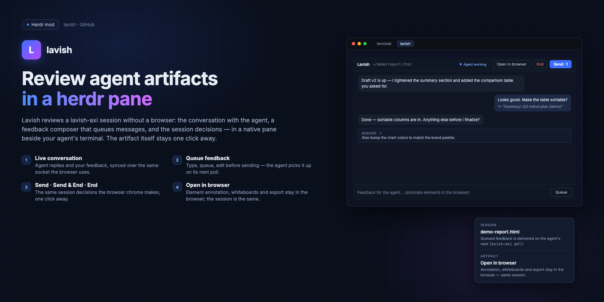
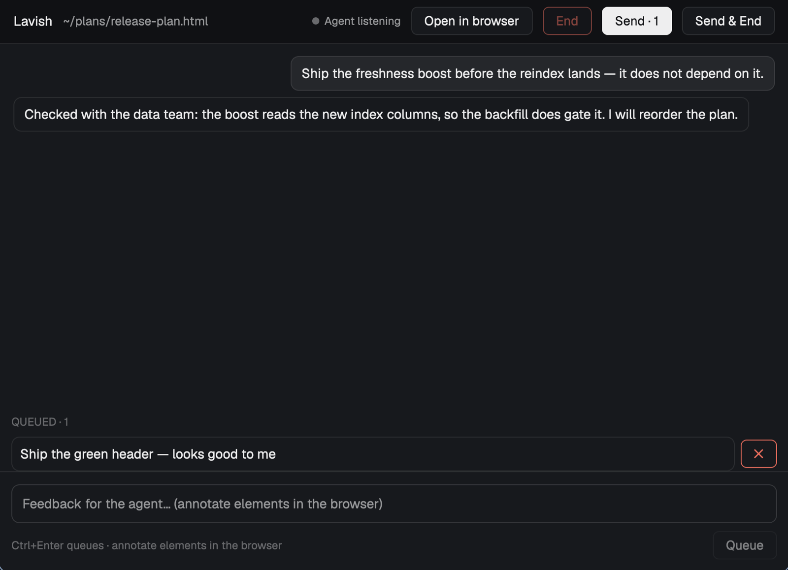

# herdr-lavish

Review lavish-axi sessions in a herdr-app pane instead of a browser tab.



Lavish runs as usual: same CLI, same local server, same feedback for the
agent. Only the review surface changes. The session opens as a native pane
beside the agent's terminal — the conversation, the feedback queue and the
session decisions — talking to the same HTTP and WebSocket API the browser
page uses. The artifact itself stays one click away in the browser.



## What is Lavish?

[Lavish](https://github.com/kunchenguid/lavish-axi)
([lavish-axi](https://www.npmjs.com/package/lavish-axi) on npm) is a CLI that
lets an AI agent hand you an HTML artifact — a plan, report, or prototype —
for review in your browser. You annotate elements and text, edit diagrams,
and queue feedback; the agent picks it up with `lavish-axi poll` and updates
the artifact. This mod moves that review session into a herdr-app pane
instead of a browser tab.

## Install

Needs herdr-app, [lavish-axi](https://www.npmjs.com/package/lavish-axi) and `jq`.

```sh
git clone https://github.com/sjennings/herdr-lavish
cd herdr-lavish && ./install.sh
```

This links three things to this checkout:

- `mods/lavish/` as the herdr mod `lavish` (`~/.config/herdr-app/mods/lavish`)
- `bin/lavish-herdr` into `~/.local/bin`
- `skill/lavish-herdr` into `~/.claude/skills`, so agents know the command

## Use

Ask the agent to open an artifact "in herdr", or run it yourself:

```sh
lavish-herdr .lavish/plan.html     # same arguments as lavish-axi
```

Everything else is unchanged: the agent keeps using `lavish-axi poll`,
`reply` and `end` exactly as before — `lavish-herdr poll`, `reply`, `end`
and every other subcommand pass straight through to `lavish-axi`.

lavish-axi has no browser-command override (its browser open is the `open`
package, suppressed only by `--no-open`), so the launcher wraps the open
command with `--no-open` and opens the pane itself. With no herdr window
it opens the browser instead and says so on stderr. Set
`LAVISH_HERDR_PLACE` to `down` or `tab` to open the pane there instead of
on the right.

## What is native

| The session, in the pane | How |
| --- | --- |
| Conversation | every feedback round and agent reply, including annotations given in the browser (shown with their quoted text) |
| Queue feedback | type messages, queue them (Ctrl+Enter), edit or remove before sending |
| Send | `POST /api/:key/prompts` — the same call the browser chrome makes; the agent's `poll` returns it like browser feedback |
| Send & End | the same call with `endSession: true`; the pane then closes itself |
| End | `POST /api/:key/end` |
| Agent presence | "Agent working / listening" while the live socket is up |
| Open in browser | the same session URL in the web UI |

## Limits (use Open in browser)

The pane cannot draw the artifact itself — herdr-app has no web view, and a
Lavish artifact is arbitrary HTML — so element and text annotation,
attachments, Mermaid whiteboard editing, layout-warnings triage, export and
share stay in the browser. The session is the same; nothing is lost.

One server behavior to know: `lavish-axi poll` reports
`browser_disconnected` after a **connected** review window leaves. A
pane-only session never triggers it, but if you open the browser from the
pane and later close it, the poll may report `browser_disconnected` while
the pane keeps working; the agent will ask whether to reopen.

## Develop

Read `DESIGN.md` for the architecture, `RECIPE.md` for the build-from-scratch
brief (the herdr.dev/mods listing format).

```sh
npm test                      # session model, launcher, install (node --test)
herdr-app check mods/lavish   # after every mod change
tests/pane-e2e.sh             # live: a real session driven through a pane,
                              # on a space the script opens and closes itself
```

## Uninstall

```sh
rm ~/.config/herdr-app/mods/lavish ~/.local/bin/lavish-herdr ~/.claude/skills/lavish-herdr
```

## License

MIT — see [LICENSE](LICENSE).
