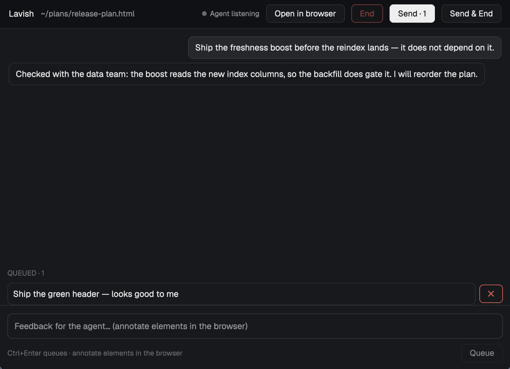

# Lavish

A pane (or tab) named `lavish` that reviews a [lavish-axi](https://www.npmjs.com/package/lavish-axi)
session without a browser: the conversation with the agent, a feedback
composer that queues messages, and the session decisions — Send, Send & End,
End. The artifact itself is arbitrary HTML, which a herdr pane cannot draw,
so the pane carries **Open in browser** for that and for annotation; the
session is the same one either way.

## What you see

- **Header**, 44 px, `chrome` background (`0c1016` in the default dark
  theme), bottom border. **Lavish** in 13 px semibold, then the artifact
  path under home shortened to `~/` in 12 px `muted`. On the right, buttons
  28 px tall, 12 px padding, 12.5 px text: **Open in browser** (always),
  **End** (red `blocked` text, disabled while anything is queued), then
  **Send · n** (primary, `solid` background) and **Send & End** once the
  queue has items. When the live socket reports the agent, a 7 px dot and
  11 px label — `accent` for **Agent working**, `dim` for **Agent
  listening**.
- **Conversation**, `background` (`111720`), fills the pane. Agent entries
  left-aligned in `surface` bubbles; user entries right-aligned in
  `popover` bubbles — 13 px text, 6/10 px padding, 8 px corners. A user
  entry that was an element annotation shows its quoted text in 12 px
  italic `muted`; non-message kinds (whiteboard, layout fixes) get a 10 px
  label. Empty state: one `dim` hint line.
- **Queued · n** section between conversation and composer, only with
  items: 11 px `dim` heading, then each queued message in a bordered box.
  Click to edit (inline `Textarea`, Ctrl+Enter saves, Esc cancels, Save /
  Cancel buttons), ✕ removes.
- **Composer** at the bottom, top border: a `Textarea` (13 px) with the
  placeholder "Feedback for the agent… (annotate elements in the
  browser)", a Queue button on the right, and an 11 px `dim` hint
  "Ctrl+Enter queues · annotate elements in the browser" on the left.
- **Toast** strip under the header (12 px, `surface`) for send failures and
  confirmations; **Loading session…** / error text / **Session ended.
  Return to your agent.** centered in 14 px while not ready. After Send &
  End or End: "Feedback sent. Session ended." and the pane closes itself
  after 2 s.

## How it behaves

- `lavish-herdr <file.html>` runs `lavish-axi <file> --no-open`, opens this
  pane beside the agent's terminal (`$HC_TERMINAL_ID` → `herdr-app ls` →
  `pane.split right`), or as a tab (`LAVISH_HERDR_PLACE=down|tab`), relays
  the CLI's stdout and exit code untouched, and exits. With no herdr
  window it opens the session URL with the system opener instead. Every
  other subcommand (`poll`, `reply`, `end`, …) passes straight through to
  `lavish-axi`.
- State machine: `loading → ready → sending → sent` and
  `loading → error`; `sending → ready` again on failure with a toast.
  `ended` (from the page state, the live `ended` event, or a 409) is
  read-only: composer hidden, only Open in browser stays.
- Bootstraps from the page the browser loads — `GET /session/<key>`, the
  `<script id="lavish-session" type="application/json">` payload — then
  subscribes to the same live socket the browser chrome uses
  (`WS /events/<key>`): `chat-sync` replaces the chat on newer revisions,
  `agent-presence` drives the dot, `ended` ends the pane. If the socket
  cannot connect or drops, it re-fetches the session page every 2.5 s and
  diffs `chat_revision`, so updates get slower, never dead.
- Typing then Ctrl+Enter (or Queue) queues a message. **Send** posts
  `{prompts:[…], domSnapshot:""}` to `/api/<key>/prompts` — the exact body
  the browser conversation panel sends, tag `message` — and stays open for
  more rounds. **Send & End** adds `endSession: true`. **End** (only with
  an empty queue) posts `/api/<key>/end`. The running `lavish-axi poll`
  receives the feedback like browser feedback. Every request carries
  `Origin: <session origin>` because the server refuses cross-origin
  writes.
- Dev/test only: `props().steps` (`[["queue","text"],["send"],…]`) replays
  those actions 400 ms apart after load, and `props().dump` writes a state
  snapshot (compare-and-swap via `writeTextFile`) for scripts to assert
  on. Normal use sets neither.

## Built from

- `mods/lavish/` (`mod.json` `{ "place": "none" }`: appears only where the
  launcher puts it):
  - `main.js` — the `View`: state machine, header, conversation, queue,
    composer, decisions; `props().pane` for safe self-close via
    `run("pane.close")`; `cx.spawn` tasks, `cx.sleep`, `cx.timer.after`.
  - `api.js` — `Api`: `fetch` GET/POST with the Origin header,
    `WebSocket` from `websocket` for `/events/<key>` with drop callback.
  - `session.js` — pure model, no imports: `keyFromUrl`,
    `sessionFromChromeHtml` (the `#lavish-session` parse), `normalizeChat`,
    `applyChatSync` (revision-guarded), `queuedPrompt`/`sendBody` (the
    chrome's request bodies).
- `herdr` functions: `props`, `run`, `theme`, `home`, `writeTextFile`,
  `readTextFile`; globals `fetch` and `websocket.WebSocket`.
- Programs: the mod runs none. The launcher (`bin/lavish-herdr`, POSIX sh
  with `jq`) runs `lavish-axi`, `herdr-app` (`status`, `ls`, `do
  pane.split/tab.new`) and `open`/`xdg-open` as the fallback.
- Network: the mod reaches only the session origin it was given — the
  session page, the prompts and end endpoints, the events socket.
- `skill/lavish-herdr/SKILL.md` — the agent skill; `install.sh` links the
  mod into `~/.config/herdr-app/mods`, the launcher into `~/.local/bin`,
  the skill into `~/.claude/skills`, then `herdr-app check`s the mod.

## Watch out

- herdr-app has **no web view**; the artifact, element/text annotation,
  attachments, whiteboard editing, layout-warnings triage, export and
  share are browser-only. Open in browser, same session.
- The server rejects writes without a matching `Origin` — every POST and
  the socket upgrade must send it. A pane-only session never triggers
  `browser_disconnected` (the server only schedules it after a connected
  window *leaves*), but closing a browser window you opened from the pane
  can make `poll` report it while the pane still works.
- `writeTextFile` is compare-and-swap: `expected: null` only creates.
  Repeated dumps must pass the previous text (or re-read) or they silently
  reject — the state dump does exactly that.
- The sandbox has no `setTimeout`; use `cx.sleep`/`cx.timer`. Tasks run
  in background panes too — a pane on an unselected space still replays
  steps and polls.
- The launcher must accept lavish-axi's two output shapes: JSON for
  agents, YAML-style for humans; both quote the session URL (jq first,
  then a `sed` fallback).
- Mod pane props are `{url}` (the session URL); the key is its last path
  segment and must be 6–32 lowercase hex characters (`keyFromUrl`), else
  the pane shows the error state. `dump`/`steps` are test-only.

## Done when

- `herdr-app check mods/lavish` passes.
- `node --test tests/*.test.js` passes (session model, launcher with
  stubbed binaries, install into a temp `HOME`/`HERDR_APP_HOME`).
- `tests/pane-e2e.sh` prints `all pane e2e cases passed`: a real session
  loads in a pane on a space the script owns, a browser-shaped POST
  appears in the pane's conversation, the steps replay queues feedback and
  Send & Ends it, and the server-side session page then reports ended.
- `lavish-herdr <file.html>` with no herdr window prints `no herdr window;
  opening the browser instead` on stderr and still relays the CLI output.
